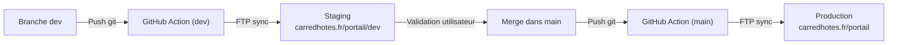

# Portail Voyageurs — Conciergerie Carré d'Hôtes

Application Web Progressive (PWA) et portail d'accueil numérique pour les voyageurs de la conciergerie **Carré d'Hôtes** à Lyon.

* **Production** : [https://www.carredhotes.fr/portail/](https://www.carredhotes.fr/portail/) (dossier `www/portail/` sur le serveur OVH)
* **Staging / Développement** : [https://www.carredhotes.fr/portail/dev/](https://www.carredhotes.fr/portail/dev/) (dossier `www/portail/dev/`)

---

## 🌟 Fonctionnalités & Expérience Utilisateur

### 📱 Progressive Web App (PWA) & Installation Personnalisée
- **Manifeste PWA Dynamique (`manifest.php`)** : Génère un manifeste sur-mesure pour chaque hébergement (`/portail/{slug}`). Lorsqu'un voyageur installe l'application, l'icône et le nom de l'application mobile ciblent directement son logement.
- **Service Worker (`sw.js`)** : Stratégie de cache *Stale-While-Revalidate* pour l'App Shell et les modules JS, avec consultation hors-ligne des guides déjà ouverts.
- **Bannière d'installation intelligente** : Détection du mode autonome, instructions dédiées pour iOS Safari (bouton Partager) et invite native pour Android / Chrome.

### 📖 Guides de Bienvenue & Lecteur PDF Vectoriel Universel
- **Intégration Mozilla PDF.js** : Affichage vectoriel haute définition du livret d'accueil sans dépendre des visionneuses tierces des navigateurs.
- **Pinch-to-Zoom centré & Pan fluide** : Zoom tactile multipoint jusqu'à 4x centré sur le pincement de doigts, avec gestion du défilement et rebond élastique.
- **Streaming direct anti-CORS (`api.php?pdf=1`)** : Passerelle même origine sécurisée permettant le chargement fluide des guides hébergés sur Cloudflare R2 ou Google Drive.
- **Support bilingue dynamique** : Bascule instantanée entre le livret français (`guide_fr_url`) et anglais (`guide_en_url`).

### 🎬 Vidéos des Équipements & Tutoriels
- **Format vertical optimisé (9:16)** : Lecteur adapté aux formats smartphones (720x1280) pour visualiser immédiatement le fonctionnement de l'électroménager (cafetière, lave-linge, plaques induction, etc.).
- **Recherche instantanée** : Filtre de recherche en temps réel par mot-clé avec annonce vocale pour l'accessibilité.
- **Compatible R2 & Google Drive** : Prise en charge native des fichiers MP4 directs et des iframes Google Drive `/preview`.

### ⚡ Accompagnement Gestuel Mobile (*Swipe to Dismiss* & Tabs)
- **Gestuelle modale physique** : Accompagnement 1:1 au doigt ou à la souris sur l'en-tête et la poignée.
  - Relâchement à plus de 50% du parcours (ou geste rapide vers le bas) -> fermeture assistée.
  - Relâchement avant 50% -> réouverture élastique à la position initiale.
- **Navigation tactile par balayage (*Swipe*)** : Glissement latéral naturel entre l'onglet « Informations » et l'onglet « Vidéos » avec micro-animations de rebond sur les icônes.

### 🌐 Réservation Directe Superhote
- **Moteur de réservation synchronisé** : Intégration de l'iframe de recherche Superhote (`/rentals-search`).
- **Multilingue automatique** : Adaptation dynamique de l'URL selon la langue active du portail (`/rentals-search?lang=en` en anglais, `/rentals-search` en français).

### 📶 Wi-Fi, Avis Google & Contact Conciergerie
- **Modale Wi-Fi** : Affichage clair du SSID et mot de passe avec copie en un clic et notification toast.
- **Avis Google 5 étoiles** : Modale d'incitation avec redirection directe vers la fiche Google Maps Carré d'Hôtes.
- **Triage & Contact WhatsApp** : Modale de contact dédiée redirigeant vers Anthony (concierge référent 7j/7) après triage des besoins immédiats.

### ♿ Accessibilité (WCAG AA) & Dark Mode
- **Contraste certifié WCAG AA** : Palette calibrée (`text-ink-faint` à `#525c6e` pour un ratio supérieur à 5:1 sur fond clair).
- **Lecteurs d'écran (A11y)** : Balisage `aria-hidden="true"` sur les pictogrammes décoratifs et zone `aria-live="polite"` pour les annonces vocales (copie Wi-Fi, bascule de langue, etc.).
- **Mode Sombre / Clair** : Détection automatique des préférences système et bascule manuelle avec mémorisation (`localStorage`), adaptée aux Safe Areas iOS.

---

## 🔒 Sécurité & Robustesse

| Vecteur d'attaque | Protection mise en place |
| :--- | :--- |
| **Fuite des identifiants MySQL** | Identifiants confinés dans le fichier `.env`. Le fichier `.htaccess` bloque strictement tout accès HTTP aux fichiers `.env`. |
| **Attaques SSRF (Server-Side Request Forgery)** | Validation stricte du schéma (`https://` ou `http://`) et blocage des adresses privées / de boucle locale (`127.0.0.1`, `10.*`, `192.168.*`, `172.16-31.*`) dans le proxy PDF de `api.php`. |
| **Injections SQL** | Requêtes préparées PDO avec typage strict et validation regex des slugs (`/^[a-z0-9_\-]{1,100}$/`). |
| **Failles XSS (Cross-Site Scripting)** | Échappement systématique des chaînes dynamiques (`Utils.escapeHtml`) et assainissement des classes CSS et URLs externes. |
| **Outil de diagnostic `test-db.php`** | Confiné dans `tools/`, protégé par clé d'autorisation API (`GATEWAY_API_KEY`), bloqué en HTTP par `.htaccess` et exclu des déploiements FTP. |
| **Protection des dossiers sensibles** | Règle Apache stricte bloquant l'accès direct aux répertoires `src/`, `config/`, `database/` et `tools/`. |
| **En-têtes de sécurité HTTP** | `X-Content-Type-Options: nosniff`, `X-Frame-Options: SAMEORIGIN`, `Referrer-Policy: strict-origin-when-cross-origin`, `Permissions-Policy`. |
| **Performance HTTP** | Compression GZIP automatique et en-têtes `Cache-Control: public, max-age=31536000, immutable` pour les images et assets statiques versionnés. |

---

## 📁 Architecture & Structure du Projet

```text
portail/
├── .github/
│   └── workflows/
│       └── deploy.yml            # CI/CD : Déploiement FTP automatique sur dev et main
├── .htaccess                     # Configuration Apache, réécriture SPA, sécurité & cache
├── api.php                       # Passerelle JSON sécurisée vers MySQL 8.4 & flux PDF
├── index.php                     # Point d'entrée SSR : injection dynamique des métadonnées PWA
├── index.html                    # Interface utilisateur SPA épurée (Tailwind CDN)
├── manifest.php                  # Générateur dynamique de manifeste PWA par logement
├── manifest.webmanifest          # Manifeste PWA statique de repli
├── sw.js                         # Service Worker PWA (mise en cache & offline)
│
├── config/
│   └── database.php              # Pont de configuration et rétrocompatibilité globale
│
├── src/                          # Architecture Backend PHP modulaire
│   ├── Env.php                   # Chargeur .env autonome et typé
│   ├── Database.php              # Singleton PDO MySQL 8.4 sécurisé
│   └── Repository/
│       └── PropertyRepository.php # Requêtes préparées (logements & vidéos)
│
├── tools/                        # Outils d'administration technique
│   └── test-db.php               # Diagnostic MySQL protégé par clé d'API
│
├── database/                     # Schémas et migrations SQL
│   ├── schema.sql                # Structure des tables (properties, videos)
│   ├── seed.sql                  # Données initiales des logements
│   └── install.sql               # Script d'installation initial
│
├── assets/
│   ├── css/
│   │   └── custom.css            # Feuille de styles unifiée, animations & Dark Mode
│   ├── images/                   # Logos et pictos clair/sombre
│   ├── icons/                    # Icônes PWA haute résolution (192px, 512px, maskable)
│   └── js/
│       ├── app.js                # Orchestrateur ES6 principal & pont de compatibilité
│       └── modules/              # Modules JavaScript ES6 spécialisés
│           ├── state.js          # État réactif global (AppState)
│           ├── utils.js          # Sécurité XSS, clipboard et helpers
│           ├── i18n.js           # Dictionnaires FR/EN et moteur de traduction
│           ├── theme.js          # Thème clair/sombre et Safe Area iOS
│           ├── scroll.js         # Gestion du défilement et calculs de hauteurs
│           ├── router.js         # Routeur SPA sans rechargement
│           ├── api.js            # Client réseau API et gestion hors-ligne
│           ├── gestures.js       # Contrôleurs tactiles (swipe modales & onglets)
│           ├── pdf-viewer.js     # Moteur vectoriel Mozilla PDF.js & zoom centré
│           ├── modals.js         # Gestionnaire de modales (PDF, vidéos, booking, Wi-Fi)
│           ├── renderer.js       # Rendu des logements, listes et recherche de vidéos
│           └── pwa.js            # Cycle de vie PWA et invites d'installation
│
└── passerelle-cdh-8d3f7a/        # Passerelle API interne sécurisée par clé
    ├── config.php
    └── index.php
```

---

## 🚀 Protocole de Déploiement CI/CD (GitHub Actions)

Le déploiement est entièrement automatisé via le workflow [`.github/workflows/deploy.yml`](.github/workflows/deploy.yml) qui synchronise les fichiers par FTP vers l'hébergement mutualisé OVH.



### Règles de Déploiement :
1. **Branche `dev`** : Tout développement ou correctif est implémenté et poussé sur `dev`. Le déploiement s'effectue automatiquement sur `www/portail/dev/` pour vérification par l'équipe.
2. **Branche `main` (Production)** : **Ne jamais pousser ni fusionner sur `main` sans l'accord écrit explicite de l'utilisateur.** Une fois validée sur l'environnement staging, la branche `dev` est fusionnée dans `main`, déclenchant la mise en production immédiate sur `www/portail/`.
